  

### liner notes

Lê Phạm Minh Triết. I study Computer Science at the University of Information Technology (VNU-HCM), and I spend most of my time where AI and language meet things people actually touch. I care about the engineering underneath and about how it feels to use. These five tracks are what that sounds like so far.

### side a

- **UIT Campus Explorer**: Interactive 3D campus exploration experience.
- **Vietnamese Sarcasm**: Context-aware Vietnamese sarcasm dataset and research.
- **AI Video Retrieval**: Multimodal video search and retrieval system.

### side b

- **Packed**: Collaborative group travel planning experience.
- **Mental Health RAG**: Retrieval-augmented conversational AI.

— Minh Triet · AI · NLP · Creative Engineering · Interactive Web
