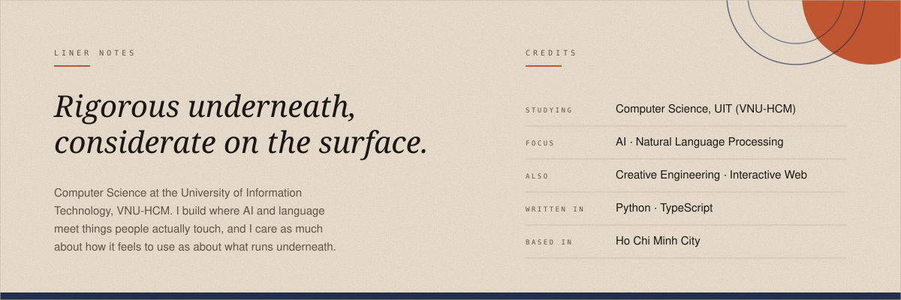

  

  

  

  

  

liner notes, as plain text

 

**Lê Phạm Minh Triết.** I study Computer Science at the University of Information Technology (VNU-HCM), and I spend most of my time where AI and language meet things people actually touch. I care about the engineering underneath and about how it feels to use.

**Side A**
- **UIT Campus Explorer**: Interactive 3D campus exploration experience.
- **Vietnamese Sarcasm**: Context-aware Vietnamese sarcasm dataset and research.
- **AI Video Retrieval**: Multimodal video search and retrieval system.

**Side B**
- **Packed**: Collaborative group travel planning experience.
- **Mental Health RAG**: Retrieval-augmented conversational AI.

